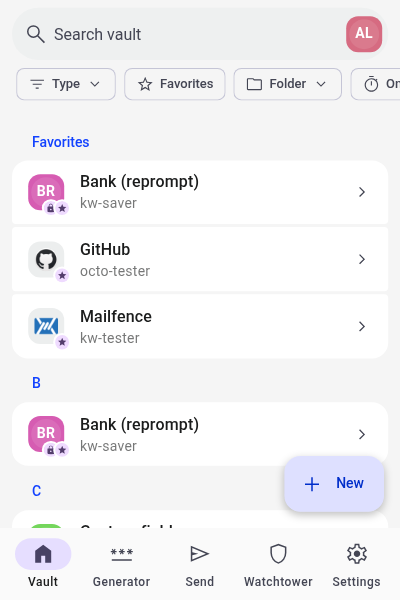
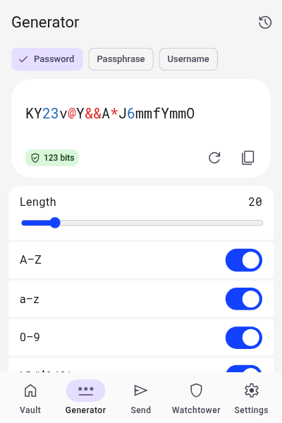
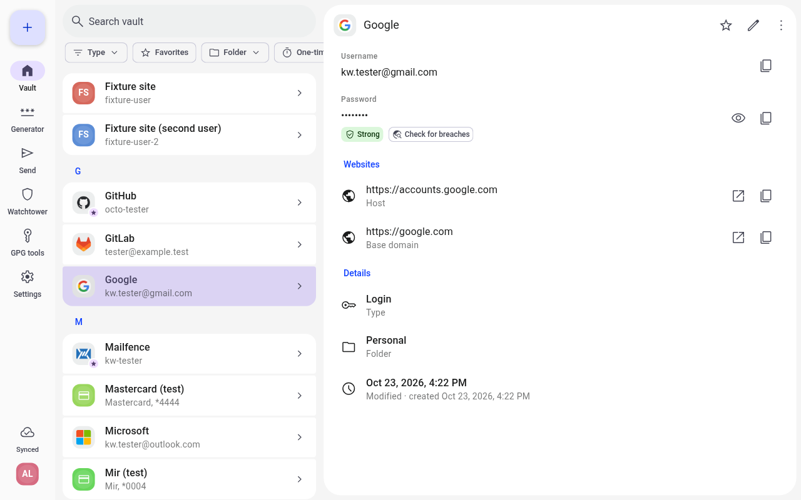
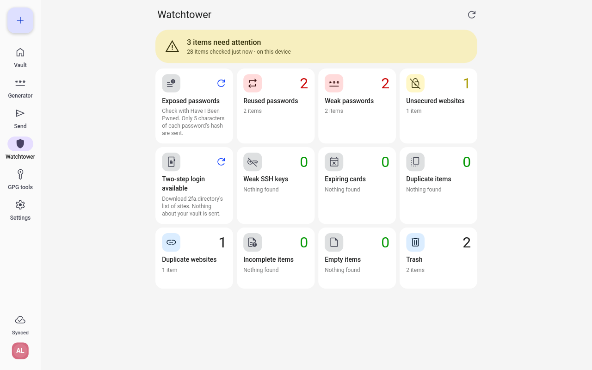

# Keyward

A fast browser extension for Bitwarden and Vaultwarden vaults, with the look of the
[Keyguard](https://github.com/AChep/keyguard-app) Android app. Built for Chromium-based
browsers (Helium, Chromium) and Firefox-based ones (LibreWolf, Firefox) on Linux.

<p>
  
  
</p>



## Features

- Logins, cards, identities, notes, SSH keys and GPG keys (stored the way Keyguard stores them).
- Autofill with an inline menu, multi-step and two-step logins, TOTP codes, save and update prompts.
- Passkeys, and security-key two-step login to the vault.
- Several accounts, PIN unlock, organizations and collections, Send, attachments.
- Password, passphrase and email-alias generator; Watchtower health checks.
- Import and export in Bitwarden's formats.

## Install

Build it yourself (Node 24+):

```sh
npm install
cp .env.example .env     # optional: your server URL and Firefox add-on id
npm run package          # dist/keyward-<version>-chromium.zip and -firefox.xpi
```

Loading it in each browser: [docs/INSTALL.md](docs/INSTALL.md).

## Develop

```sh
npm run build            # dist/chromium, dist/firefox
npm run dev-server up    # local Vaultwarden + mailpit in podman
npm run seed             # test accounts -> tests/.env.test (git-ignored)
npm test                 # unit tests
npm run e2e              # end-to-end tests in Helium and LibreWolf
```

More: [manual test checklist](docs/MANUAL-TEST.md),
[audit of the official extension](docs/audit-official-extension.md),
[protocol notes](docs/protocol.md), [design tokens](docs/design.md).

## Credits and licenses

Keyward is licensed under the [GNU GPL v3.0](LICENSE).

- **Bitwarden** ([bitwarden/clients](https://github.com/bitwarden/clients), GPL-3.0): the
  protocol and vault formats Keyward implements were studied from the official clients.
  Keyward is an independent project, not affiliated with or endorsed by Bitwarden, Inc.;
  "Bitwarden" is their trademark.
- **Vaultwarden** ([dani-garcia/vaultwarden](https://github.com/dani-garcia/vaultwarden),
  AGPL-3.0): the server Keyward is tested against. No code is used.
- **Keyguard** ([AChep/keyguard-app](https://github.com/AChep/keyguard-app), source available
  for personal use only): the visual design is inspired by it. No Keyguard code or assets are
  included; the GPG field names are used only so both apps read the same items.
- Bundled: [Preact](https://preactjs.com) (MIT), [OpenPGP.js](https://openpgpjs.org)
  (LGPL-3.0+), [zxcvbn-ts](https://github.com/zxcvbn-ts/zxcvbn) (MIT),
  [argon2id](https://github.com/openpgpjs/argon2id) (MIT),
  [tldts](https://github.com/remusao/tldts) (MIT), Roboto and Roboto Mono fonts (OFL-1.1),
  [Material Symbols](https://github.com/google/material-design-icons) (Apache-2.0),
  [material-color-utilities](https://github.com/material-foundation/material-color-utilities)
  (Apache-2.0), and the [EFF large wordlist](https://www.eff.org/dice) (CC BY 3.0 US).
